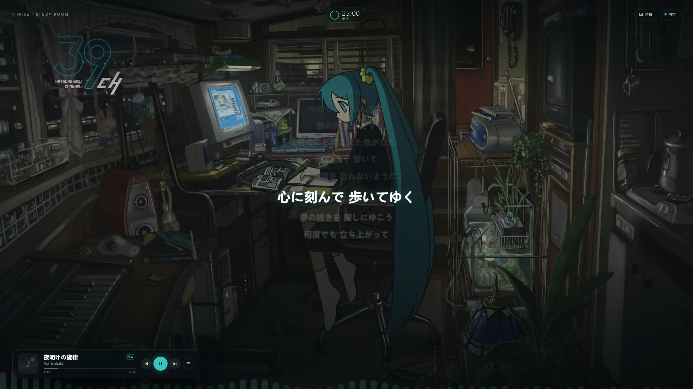

# Miku Study Room · 音乐壁纸 v1.0

> 本分支包含[透明桌面歌词层实验](experimental/desktop-overlay/README.md)。**存在切换壁纸后阻塞桌面点击的已知问题，尚未完成验收，不是稳定版本。** 原版壁纸说明保留如下；实验代码位于独立目录。

新增“唱片”歌词模式：在设置 → 歌词特效 → 唱片中选择。歌词按词提取，从底部播放口依次浮出，各自沿舒展的环绕轨迹上升、散开、淡去，沿用当前字体和配色；原有模式及胶囊播放器保留。

一张会跟着网易云音乐变化的 Wallpaper Engine 网页壁纸：动态场景、居中滚动歌词、封面、进度、切歌。



## 需要什么

| 依赖 | 说明 |
| --- | --- |
| Windows 10 / 11 | — |
| Wallpaper Engine | 必需 |
| 网易云音乐 PC 客户端 | 跟随模式需要它；请保持运行（可以最小化） |
| 联网 | 拉取封面、歌词（网易云搜索 + Meting 接口） |

不需要安装 Python、Node、ffmpeg 或任何第三方播放器。控制桥是随包附带的 9KB 小程序。

## 安装

1. 解压压缩包到任意目录（路径不要有特殊符号）
2. 双击 **`安装.bat`**
3. 安装脚本会：
   - 找到 Wallpaper Engine
   - 把壁纸工程复制到 `projects\myprojects\Miku Study Room`
   - 把控制桥安装到 `%LOCALAPPDATA%\MikuWallpaper\bridge`
   - 启动控制桥，并把壁纸应用到主显示器
   - 询问是否开机自启
4. 完成。桌面上点一下壁纸即可（如果没自动应用，去 WE 的“已安装”里选 `Miku Study Room`）

## 使用

### v1.0 包含

- 歌词模式：简洁 / 浮名 / 流光 / 心象 / 倾诉 / 青书
- 浮名三句联动、整句漂浮 + 逐字波动，当前句薄荷青高光
- 心象逐字不规则漂浮；倾诉按 AI 关键词放大变形
- 青书竖排多列、左右平移；简洁当前句主题色高光
- 10 套字体、歌词偏移 0.1s 步进
- 胶囊上的眼睛按钮：只保留专辑封面，点封面右上角眼睛恢复
- 本地桥接看门狗：崩溃自动拉起；设置里可手动重启、查看使用引导
- AI 主题按歌曲缓存，歌词本地缓存 200 首

### 基本用法

- 在网易云里播放歌曲，壁纸会自动切成「跟随系统」，显示歌名、封面、歌词
- 壁纸上的 ⏮ ⏸ ⏭ 控制网易云（走它的全局快捷键）
- 右上角「背景」切换 3 段动态场景
- 「内置」模式：壁纸自己播放 Meting 歌单（默认 STUDY WITH MIKU），不需要网易云；歌单可点、可翻页
- 跟随模式下歌单按钮会隐藏（队列是只读的，避免误导）

### 如果你的切歌按钮没反应

网易云 → 设置 → 快捷键，确认「全局快捷键」和「使用系统媒体快捷键」都勾选，并记下：

- 播放/暂停
- 上一首
- 下一首

然后编辑：

```
%LOCALAPPDATA%\MikuWallpaper\bridge\hotkeys.ini
```

```ini
next=ctrl+alt+right
prev=ctrl+alt+left
playpause=ctrl+alt+p
```

改成你的组合，重启 `bridge.exe`。

## 已知限制

- **进度是估算的**：网易云不把播放时间轴交给 Windows（不注册 SMTC），壁纸只能从切歌开始自己计时。在客户端拖动进度条后，壁纸进度和歌词会偏，直到下一首。
- 跟随模式依赖网易云的窗口标题和本地播放队列文件 `%LOCALAPPDATA%\NetEase\CloudMusic\webdata\file\playingList`；客户端大版本更新后路径可能变化。
- 跟随模式下歌单是只读的（无法点歌），切歌请用播放器按钮或网易云。
- 背景视频来自 StudyWithMiku 仓库的同人素材，**仅限个人使用**，不要二次分发或商用。

## 卸载

1. WE 里删除 `Miku Study Room` 工程
2. 删除 `%LOCALAPPDATA%\MikuWallpaper`
3. 删除启动文件夹里的 `MikuWallpaperBridge.lnk`（如果创建过）

## 隐私

- 控制桥只监听 `127.0.0.1:51789`，不对外网开放
- 它只读取：网易云窗口标题、`playingList` 播放队列文件
- 壁纸只向网易云搜索接口和 Meting 接口请求歌曲信息/封面/歌词

## 致谢

- 背景视频与场景素材：[StudyWithMiku](https://github.com/shshouse/StudyWithMiku)
- 音乐接口：[Meting](https://github.com/metowolf/Meting)
- 壁纸引擎：[Wallpaper Engine](https://www.wallpaperengine.io/)

## 参考与致谢

本项目为个人学习与自用作品，视觉与交互上参考了以下项目/服务，代码为自行实现：

- **Folia**：歌词视觉模式的灵感来源（浮名、流光、心象、云阶、群唱、倾诉、花火等命名与动效方向）。本项目在其基础上做了取舍与重做，最终保留 6 种模式。
- **Wallpaper Engine**（Steam）：网页壁纸运行环境与音频/媒体接口。
- **网易云音乐 PC 客户端**：跟随模式的数据来源（窗口标题、播放列表）与控制方式（全局快捷键）。
- **Meting / metowolf**：歌词、封面、歌单的聚合接口；本项目使用 `api.injahow.cn/meting` 公共实例。
- **初音未来 / HATSUNE MIKU CHANNEL（39ch）**：背景插画、房间场景与「STUDY WITH MIKU」主题来自初音未来相关企划；角色与美术版权归 Crypton Future Media 及原画作者所有，本项目仅作非商业自用展示。
- **MiSans**（小米）：内置默认中文字体。
- **Noto Sans SC / Noto Serif SC**（Google）：备用字体。
- Windows 系统字体：楷体、仿宋、等线、幼圆、微软雅黑等。

以上名称与版权归各自作者/公司所有，本项目不包含其源代码。
